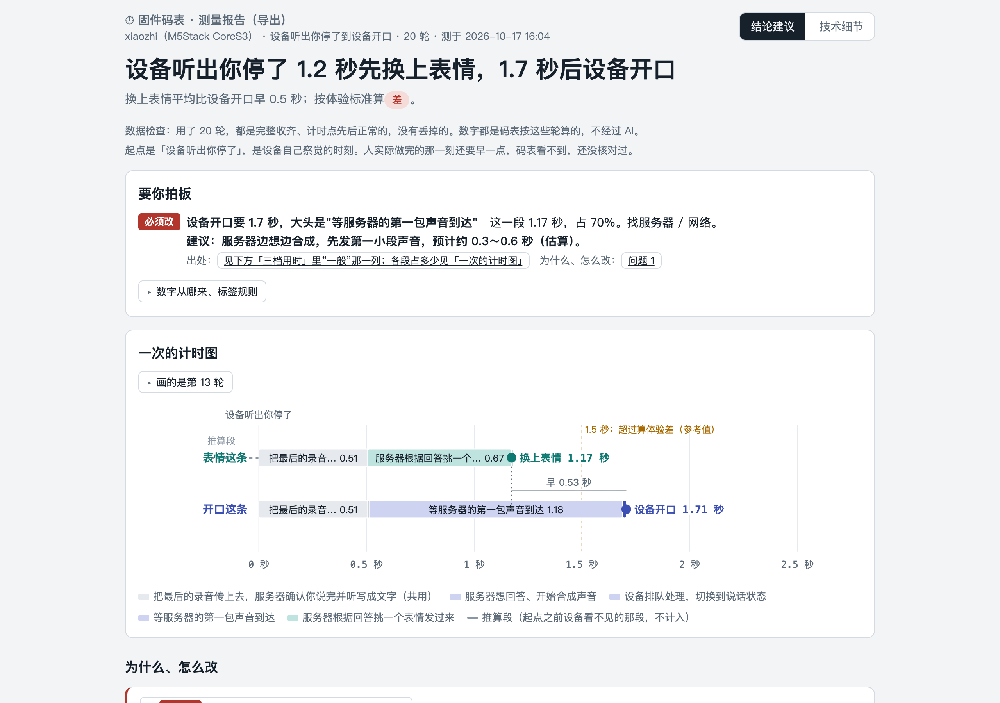

# firmware-stopwatch 固件码表

**设备反应慢，到底慢在哪一步？**

## 报告长什么样

下面是在小智（M5Stack CoreS3）上真机实测 20 轮的报告。



完整报告：[docs/示例/小智-说完话到开口.html](docs/示例/小智-说完话到开口.html)（下载后用浏览器打开）

固件码表读一份单片机固件的源码，用大模型找出关键步骤，在这些位置插入计时点（只打印时间戳，不改业务逻辑），编译、烧录后让设备真实运行多轮，最后生成分段用时报告：哪一步慢、为什么、怎么改。研发来跑，不写代码的负责人也能看懂结论。

## 目标

- **测 → 判 → 改 → 验 闭环**：测出每段用时；对照每段的合理范围判断快慢；指出最慢且能改的那段并给出修改建议；改完再测，前后对比证明变快了。
- **一份报告，两种读法**：给负责人的是结论和可选方案，给研发的是代码位置和具体改法。
- **通用**：码表事先不知道被测固件是做什么的，语音对话、门禁刷卡、按键、传感器等由事件触发的流程都按同一套方法测。只要求固件能从源码编译、能通过 USB 调试口输出日志。
- **平台路线**：乐鑫 ESP-IDF → STM32 → 树莓派 Pico。
- **不做**：全面代码审查、自动修改业务代码、监听设备间通信总线（如 485）、测量机械动作时间。

## 当前状态（v0.2.0）

第一版已完成并通过真机验收，但**只在一个固件上实测过**，请把它当作早期版本使用。

| 项目 | 状态 |
| --- | --- |
| 被测固件 | 只实测过开源项目 [xiaozhi-esp32](https://github.com/78/xiaozhi-esp32)（小智 AI 语音对话），板子是 M5Stack CoreS3（ESP32-S3），ESP-IDF v6.1 |
| 已跑通的流程 | 选择源码 → 大模型识别关键步骤 → 插入计时点 → 编译烧录 → 多轮实测 → 分段用时报告与修改建议 → 导出报告 → 一键还原原版固件；改完代码一键再测，报告和上次比 |
| 改完再测 | 计时点那几处代码没动，就沿用上次的关键步骤和插法，不调用大模型；报告写和上次比快了、慢了，还是在正常波动内。实测过把小智升级到上游新版（17 个提交） |
| 自动测试 | 639 个，覆盖语音对话、门禁刷卡等模拟场景 |
| 合理范围清单 | 每个固件一份，第一次测满 10 轮按实测自动填，报告按它判"正常 / 偏慢 / 超过慢阈值"；在「设置」里可以改 |
| 操作系统 | 苹果芯片的 Mac 实测通过；Windows 还没有实测 |
| 大模型 | Claude API、本机已登录的 Claude Code、DeepSeek |

其他乐鑫固件理论上可以走通同样的流程，但还没有验证，识别结果和合理范围可能需要较多人工确认。

**下一步**：补 Windows 实测和 STM32 支持。

## 在 Mac 上安装

需要苹果芯片的 Mac，并且已经装了 [Homebrew](https://brew.sh)。

1. 装 uv（Python 的安装工具，它会自动准备好合适版本的 Python，不动系统自带的 Python）：

   ```sh
   brew install uv
   ```

2. 拿到代码（也可以在 Releases 页面下载压缩包解开）：

   ```sh
   git clone https://github.com/seagartech/firmware-stopwatch.git
   cd firmware-stopwatch
   ```

3. 启动。第一次会自动装好需要的东西，要等几秒：

   ```sh
   uv run fsw --version
   ```

   看到 `firmware-stopwatch 0.2.0` 就是装好了。再运行 `uv run fsw`，码表会在浏览器里打开本机网页（地址是 http://127.0.0.1:8765），并告诉你还有哪些设置没填。关掉窗口或按 Ctrl+C 就停止。

## 在 Windows 上安装

> 还没在 Windows 上实测，下面的步骤可能要调整。

需要 Windows 10 或 11，并且装了 [Git](https://git-scm.com/download/win)。

1. 装 uv：打开 PowerShell，运行

   ```powershell
   powershell -ExecutionPolicy ByPass -c "irm https://astral.sh/uv/install.ps1 | iex"
   ```

   装完关掉 PowerShell 再重新打开一个。

2. 拿到代码：

   ```powershell
   git clone https://github.com/seagartech/firmware-stopwatch.git
   cd firmware-stopwatch
   ```

3. 启动：

   ```powershell
   uv run fsw --version
   ```

   看到 `firmware-stopwatch 0.2.0` 就是装好了。再运行 `uv run fsw`，码表会在浏览器里打开本机网页（地址是 http://127.0.0.1:8765），并告诉你还有哪些设置没填。关掉窗口或按 Ctrl+C 就停止。

## 设置和密钥

设置放在你自己电脑上，不在代码文件夹里：

- Mac：`~/.config/firmware-stopwatch/`
- Windows：`%USERPROFILE%\.config\firmware-stopwatch\`

把代码里的 `config.example.toml` 复制到这个文件夹，改名为 `config.toml`，照里面的说明填。以后也可以在码表网页的设置页里改。

密钥不写进 `config.toml`，单独放一个文件，只写密钥本身一行：

- Claude：`claude_key.txt`
- DeepSeek：`deepseek_key.txt`

也可以用环境变量 `ANTHROPIC_API_KEY`、`DEEPSEEK_API_KEY`，环境变量优先。选"本机已登录的 Claude Code"时不用密钥。

## 参与开发

```sh
uv run pytest                              # 跑全部自动测试
uv run python tools/check_before_upload.py # 上传前检查有没有密钥、本机路径、真实邮箱等不该公开的内容（含历史提交）
```

## 许可证

[AGPL-3.0](LICENSE)。
